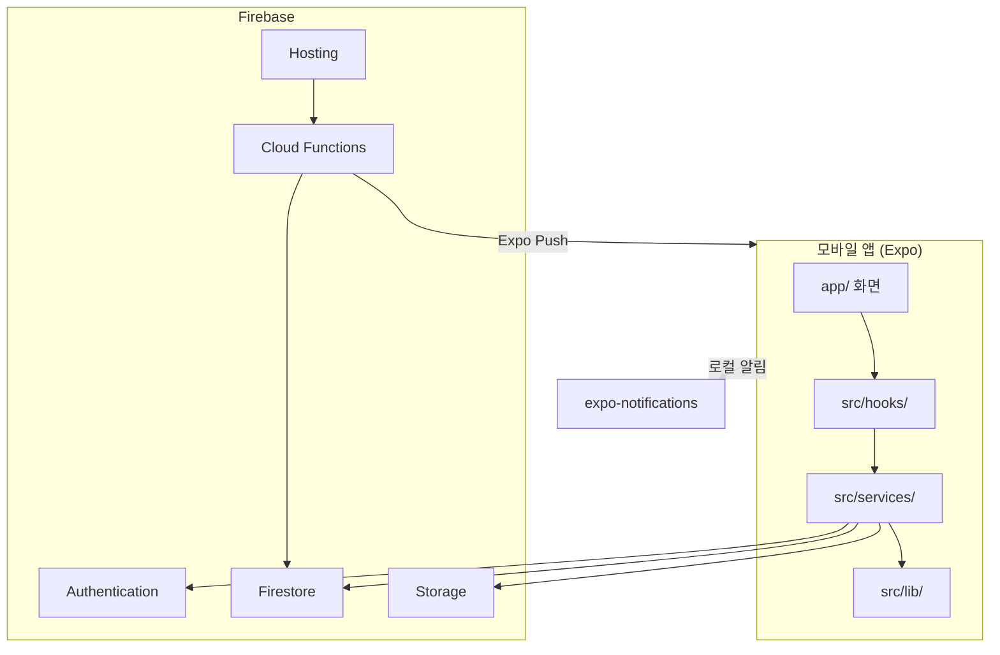

# 후회가계부 (Regret Wallet) — 코드 이해 문서

> **프로젝트명:** regret-wallet  
> **저장소:** https://github.com/yechan-00/capstone  
> **작성일:** 2026년 6월 2일  
> **목적:** 캡스톤 제출용 — 코드 구조·동작 원리·실행 방법 정리

---

## 1. 프로젝트 개요

**후회가계부**는 식비·외식 소비를 기록하고, **시간이 지난 뒤** “후회했는지”를 되돌아보게 하는 모바일 앱입니다. 단순 가계부가 아니라 **지연 리뷰(Deferred Review)** 와 **패턴 인사이트**를 결합해, 충동 소비를 줄이는 것을 목표로 합니다.

### 핵심 가치

| 기능 | 설명 |
|------|------|
| 소비 기록 | 금액, 카테고리, 사유, 기분, 태그, 사진 |
| 지연 리뷰 | 소비 **다음 날 00:00**부터 평가 가능, **47시간 59분** 창 |
| 인사이트 | 카테고리·기분·요일·시간대별 후회율 분석 |
| 예방 알림 | 전체 이력 기반 — 후회 많은 시간대 **평균 구매 시각 10분 전** 알림 |
| 공유 | 소비 카드를 웹 링크로 공유, 게스트 댓글 |

### 배포 URL 안내

| 구분 | URL | 비고 |
|------|-----|------|
| **모바일 앱 (스토어/EAS)** | 없음 | Expo Go 또는 로컬 실행으로 데모 |
| **Firebase Hosting (부분)** | https://regret-wallet-3db60.web.app | 공유 링크·OG 페이지·웹 셸만 배포 |
| **GitHub** | https://github.com/yechan-00/capstone | 소스 코드 |

> 제출 시 **“배포된 URL”** 항목은 **선택**이므로, 앱 전체가 공개 URL에 올라가 있지 않다면 **로컬 Expo Go 데모**로 충분합니다. 공유 기능만 언급할 경우 Hosting URL을 “부분 배포(공유 페이지)”로 기재할 수 있습니다.

---

## 2. 기술 스택

| 영역 | 기술 |
|------|------|
| 프레임워크 | **Expo SDK 54**, React Native 0.81, React 19 |
| 언어 | TypeScript |
| 라우팅 | **expo-router** (파일 기반, 탭 + 스택) |
| 백엔드 | **Firebase** — Auth, Firestore, Storage, Hosting, Cloud Functions |
| 알림 | **expo-notifications** (로컬) + Expo Push (Cloud Functions 원격) |
| UI | react-native-reanimated, expo-linear-gradient, react-native-svg |
| 폼/날짜 | react-hook-form, @react-native-community/datetimepicker, date-fns |
| AI (선택) | Google Gemini API — 영수증·텍스트 파싱 (`geminiService`) |

**Firebase 프로젝트:** `regret-wallet-3db60`  
**Functions 리전:** `asia-northeast3` (서울)

---

## 3. 시스템 아키텍처



### 레이어 구조

```
app/              ← UI (expo-router 화면)
  ↓
src/hooks/        ← 상태·비즈니스 조합 (useAuth, useExpenses, useInsights …)
  ↓
src/services/     ← Firestore CRUD, 알림, 공유, AI
  ↓
src/lib/          ← 타입, 상수, 순수 계산 로직
src/utils/        ← Firestore 매핑, 검증, 에러 처리
  ↓
src/lib/firebase.ts  ← Firebase SDK 초기화
```

**원칙:** 화면은 서비스를 직접 부르기보다 **훅**을 통해 데이터를 받고, 날짜·후회율 계산 같은 **순수 로직**은 `src/lib/`에 분리합니다.

---

## 4. 디렉터리 구조

```
regret-wallet/
├── app/                          # expo-router 화면
│   ├── _layout.tsx               # 루트: AuthProvider, 알림 딥링크, 스플래시
│   ├── (auth)/                   # login, signup
│   ├── (tabs)/                   # 홈, 리뷰, 추가(FAB), 인사이트, 설정
│   ├── add-expense.tsx           # 소비 추가 (전체 폼)
│   ├── edit-expense/[id].tsx     # 소비 수정
│   ├── expense/[id].tsx        # 소비 상세
│   ├── review.tsx                # 리뷰 작성 화면
│   ├── mood-insights.tsx         # 기분 인사이트 상세
│   └── settings/                 # 닉네임·이메일·비밀번호 변경
├── src/
│   ├── components/               # 재사용 UI (카드, 차트, 피커 …)
│   ├── hooks/                    # useAuth, useExpenses, useInsights …
│   ├── services/                 # Firebase·알림·공유 서비스
│   ├── lib/                      # types, reviewWindow, regretPatternAlert …
│   ├── theme/                    # ThemeContext (라이트/다크)
│   └── utils/                    # firestore 매핑, validation
├── functions/                    # Cloud Functions (Node.js)
│   ├── index.js                  # sharePage, onGuestCommentCreated, sendRegretPatternAlerts
│   └── sharePageHtml.js          # 공유 페이지 HTML 생성
├── firestore.rules               # Firestore 보안 규칙
├── firestore.indexes.json        # 복합 인덱스
├── firebase.json                 # Hosting, Functions 설정
├── app.config.js                 # Expo 설정 (EAS projectId 등)
└── .env                          # Firebase·Gemini·Share URL (로컬, git 제외)
```

---

## 5. 화면(라우트) 맵

| 경로 | 파일 | 역할 |
|------|------|------|
| `/(tabs)/index` | `app/(tabs)/index.tsx` | 홈 — 월별 캘린더, 요약, 후회 패턴 카드 |
| `/(tabs)/reviews` | `app/(tabs)/reviews.tsx` | 대기·완료 리뷰 목록 (탭 배지) |
| `/(tabs)/add` | FAB만 — `add-expense`로 이동 | 길게 누르면 빠른 입력 시트 |
| `/(tabs)/insights` | `app/(tabs)/insights.tsx` | 카테고리·기분·시간·요일 인사이트 |
| `/(tabs)/settings` | `app/(tabs)/settings.tsx` | 알림·예산·계정 설정 |
| `/add-expense` | `app/add-expense.tsx` | 소비 추가 (날짜→시간 2단계 피커) |
| `/review` | `app/review.tsx` | 만족도·후회 이유·메모 입력 |
| `/expense/[id]` | `app/expense/[id].tsx` | 소비 상세·공유·수정 |
| `/(auth)/login` | 로그인 / 게스트 | Firebase Auth |

**탭 구성:** 홈 · 리뷰(배지) · 추가(FAB) · 인사이트 · 설정

---

## 6. Firestore 데이터 모델

모든 컬렉션은 **플랫 구조**입니다. 계정 ID는 `account_{firebaseUid}` 형식 (`src/lib/accountId.ts`).

### 6.1 `accounts`

사용자당 1문서. 설정·푸시 토큰·예방 알림 슬롯 저장.

| 필드 | 설명 |
|------|------|
| `userId` | Firebase Auth UID |
| `nickname` | 표시 닉네임 |
| `reviewReminderTime` | 리뷰 알림 시각 (HH:mm, 기본 19:00) |
| `reviewReminderEnabled` | 리뷰 푸시 on/off |
| `regretPatternAlertEnabled` | 후회 패턴 예방 알림 on/off |
| `regretPatternAlertSlots` | 계산된 알림 슬롯 배열 |
| `expoPushToken` | 원격 푸시용 (Cloud Functions) |
| `monthlyIncomeAmount`, `foodBudgetAmount` | 인사이트·예산용 |
| `budgetPeriodMode` | `calendar` \| `payday` |

### 6.2 `expenses`

| 필드 | 설명 |
|------|------|
| `accountId`, `userId` | 소유자 |
| `amount`, `category` | 금액, `takeout` \| `cafe` \| `delivery` |
| `item`, `reason`, `mood`, `tags` | 무엇·왜·기분·태그 |
| `spentAt` | 실제 소비 시각 |
| `imageUrl` | Storage URL |
| `sourceType` | `manual` \| `card` \| `bank` |

### 6.3 `review_schedules`

소비 1건당 리뷰 일정. 저장 시 **로컬 알림**도 등록.

| 필드 | 설명 |
|------|------|
| `expenseId` | 연결된 소비 |
| `dueAt` | 평가 **열림** 시각 (소비 다음날 00:00) |
| `expiresAt` | dueAt + 47h59m |
| `status` | `pending` \| `done` \| `skipped` \| `expired` |
| `notificationId` | expo-notifications 식별자 |
| `type` | `d1` (신규). 레거시 `d3`, `d7`, `d30` 호환 |

### 6.4 `reviews`

| 필드 | 설명 |
|------|------|
| `decisionAgain` | `yes` \| `maybe` \| `no` |
| `satisfaction` | 1~5 |
| `regretReasons` | 후회 이유 enum 배열 |
| `scheduleId`, `expenseId` | 연결 |

### 6.5 `expense_shares` / `guest_comments`

공유 링크 토큰, OG 메타, 게스트 댓글. Hosting의 `/share/{token}` → `sharePage` Function.

### 6.6 `user_notifications`

앱 내 알림함 (게스트 댓글 등).

---

## 7. 핵심 비즈니스 로직

### 7.1 리뷰 시간 창 (`src/lib/reviewWindow.ts`)

```
소비 시각 spentAt
    ↓
dueAt = spentAt 다음날 00:00 (로컬)
expiresAt = dueAt + 47시간 59분
notifyAt = dueAt 날짜 + 설정 시각 (기본 19:00)
```

- **열림:** `now >= dueAt && now <= expiresAt`
- **평가 가능(탭 기한과 무관):** `now >= dueAt` 이고 미완료
- 리뷰 탭 배지: `usePendingReviewCount` — 평가 가능한 pending 건수

### 7.2 소비 저장 → 스케줄 → 알림

```
createExpense (expenseService)
    → createSchedulesForExpense (scheduleService)
        → Firestore review_schedules 문서 생성
        → scheduleReviewReminder (notificationService) — 로컬 알림
    → useRegretPatternAlertSync — 패턴 슬롯 재계산·동기화
```

**파일:** `src/services/expenseService.ts`, `scheduleService.ts`, `notificationService.ts`

### 7.3 후회 패턴 예방 알림 (`src/lib/regretPatternAlert.ts`)

1. **전체 소비 + 리뷰** 이력에서 요일·시간대별 후회율 계산
2. 조건: 해당 슬롯 **최소 3건**, 후회율 **≥ 25%**
3. 알림 시각: 해당 슬롯 **평균 구매 시각 − 10분**
4. **로컬:** `regretPatternAlertService.ts` — 기기에서 스케줄
5. **원격:** `accounts.regretPatternAlertSlots` 저장 → Cloud Function `sendRegretPatternAlerts`가 매시(KST) Expo Push 발송

### 7.4 알림 탭 → 화면 이동 (`src/hooks/useNotificationNavigation.ts`)

| 알림 `data.kind` | 이동 |
|------------------|------|
| (리뷰, expenseId 포함) | `/review?expenseId=&scheduleId=` |
| `regret_pattern_alert` | `/(tabs)/insights` |

콜드 스타트: `getLastNotificationResponseAsync()`로 앱 종료 상태에서 탭한 알림 처리.

### 7.5 인사이트 (`src/services/insightsService.ts`)

- 기간: 최근 30일 (설정에 따라 월급날 기준 주기 가능)
- **후회 판정:** `decisionAgain === 'no'` 또는 satisfaction ≤ 2
- 카테고리·기분·시간대·요일별 집계 → UI 카드·도넛 차트

### 7.6 공유 flow

```
shareService.createShare → expense_shares 문서
    → 링크: EXPO_PUBLIC_SHARE_BASE_URL/share/{token}
    → Hosting rewrite → sharePage Function → HTML + OG 태그
    → 게스트 댓글 → onGuestCommentCreated → user_notifications
```

---

## 8. 주요 모듈 설명

### 8.1 인증 (`src/hooks/useAuth.tsx`, `authService.ts`)

- Firebase `onAuthStateChanged`로 세션 관리
- 로그인 시 `accounts` 조회, 없으면 기본 Account 객체 생성
- 게스트: `signInAnonymously`
- 설정 변경: 리뷰 알림 시각, 후회 패턴 알림, 예산, 닉네임 등 → Firestore `accounts` 업데이트

### 8.2 소비 (`src/hooks/useExpenses.ts`, `expenseService.ts`)

- CRUD, 월별 쿼리, 이미지 업로드 (`storageService`)
- 입력 경로: 수동 폼, 빠른 입력(FAB long press), Gemini 스캔/붙여넣기

### 8.3 홈 (`app/(tabs)/index.tsx`)

- 월 캘린더 + 해당 월 소비·리뷰 상태
- **후회 많은 시간** 카드 (상단)
- **이번 달 요약** (지출·후회율)
- `loadSeqRef`로 월 전환·포커스 시 **레이스 컨디션** 방지 (stale 응답 무시)

### 8.4 리뷰 탭 (`app/(tabs)/reviews.tsx`, `app/review.tsx`)

- pending / done / skipped 그룹
- `ReviewActionCard`, 만족도·후회 이유 피커
- 완료 시 `reviewService` + `scheduleService.markDone`

### 8.5 설정 (`app/(tabs)/settings.tsx`)

- 리뷰 알림 on/off, 시각 (AlarmTimeWheel)
- 후회 패턴 예방 알림 on/off
- 월 수입·식비 예산·월급날 모드
- 로그아웃, 계정 변경 하위 화면

### 8.6 Cloud Functions (`functions/index.js`)

| Function | 트리거 | 역할 |
|----------|--------|------|
| `sharePage` | HTTP GET `/share/**` | 공유 HTML, OG, 게스트 UI |
| `onGuestCommentCreated` | Firestore create | 소유자 `user_notifications` |
| `sendRegretPatternAlerts` | Scheduler 매시 0분 KST | Expo Push 예방 알림 |

---

## 9. 상태 관리·전역 패턴

| 패턴 | 용도 |
|------|------|
| React Context | `AuthProvider`, `ThemeProvider`, `PendingReviewCountProvider` |
| Custom Hooks | 도메인별 데이터·액션 캡슐화 |
| AsyncStorage | 빠른 입력 프리셋 (`@rw_quick_presets`) |
| globalThis 콜백 | 탭 간 홈/배지 새로고침 (`__reloadHomeExpenses`, `__reloadPendingReviewCount`) |

별도 Redux/Zustand 없음 — **Firebase가 SSOT**, 로컬은 UI·캐시만.

---

## 10. 보안

- **Firestore rules** (`firestore.rules`): `request.auth.uid`와 `accountId`/`userId` 일치 시 read/write
- **Storage rules**: 본인 경로만 업로드
- **API 키:** `.env`의 `EXPO_PUBLIC_*` — 클라이언트 노출 전제, Firebase Console에서 도메인·앱 제한 권장
- **Gemini 키:** 클라이언트 호출 — 프로덕션에서는 Functions 프록시 권장

---

## 11. 환경 변수

`.env.example`을 복사해 `.env` 생성:

```env
EXPO_PUBLIC_FIREBASE_API_KEY=...
EXPO_PUBLIC_FIREBASE_AUTH_DOMAIN=...
EXPO_PUBLIC_FIREBASE_PROJECT_ID=regret-wallet-3db60
EXPO_PUBLIC_FIREBASE_STORAGE_BUCKET=...
EXPO_PUBLIC_FIREBASE_MESSAGING_SENDER_ID=...
EXPO_PUBLIC_FIREBASE_APP_ID=...

EXPO_PUBLIC_GEMINI_API_KEY=...          # 선택: AI 입력
EXPO_PUBLIC_SHARE_BASE_URL=https://regret-wallet-3db60.web.app
EXPO_PUBLIC_EAS_PROJECT_ID=...          # 선택: 원격 푸시
```

---

## 12. 실행 방법

```bash
# 1. 의존성
npm install

# 2. .env 설정 (Firebase Console에서 값 복사)

# 3. 개발 서버
npm start
# → Expo Go QR 스캔 (실기기 권장, 알림 테스트)

# 타입 검사
npm run typecheck

# iOS / Android 시뮬레이터
npm run ios
npm run android
```

**주의**

- Metro URL을 **브라우저**에서 열면 `expo-platform` 오류 — **Expo Go** 사용
- 알림·푸시는 **실기기**에서 테스트
- macOS 경로에 한글이 있으면 `scripts/ensure-ascii-path.mjs`가 prestart에서 검사

---

## 13. Firebase 배포 (개발자용)

```bash
# Functions
cd functions && npm install && cd ..
firebase deploy --only functions

# Hosting (웹 빌드 dist 필요)
firebase deploy --only hosting

# Firestore rules / indexes
firebase deploy --only firestore:rules,firestore:indexes
```

Hosting은 **공유 페이지 + SPA 셸**이며, **네이티브 앱 전체**는 App Store / Play Store / EAS Build로 별도 배포해야 합니다. 현재 스토어 배포 URL은 없습니다.

---

## 14. 데이터 흐름 요약 (한 장)

```
[사용자] 소비 입력
    → expenses 저장
    → review_schedules + 로컬 알림
    → regretPatternAlert 슬롯 재계산

[다음날] 알림 → /review
    → reviews 저장 → schedule done

[인사이트] expenses + reviews 집계
    → 홈·인사이트 탭 카드

[예방] 후회 많은 슬롯
    → 평균 구매 −10분 로컬/푸시 알림
    → insights 탭 유도
```

---

## 15. 확장·레거시 참고

- **ReviewType `shared`**, **AccountMember**: 타입만 준비, MVP는 개인용
- **ScheduleType `d3/d7/d30`**: 구버전 데이터 호환, 신규는 `d1`(다음날 오픈)
- **ExpenseCategory `food`**: `takeout`으로 정규화
- README의 Expo SDK 51 언급은 구버전 — **실제 package.json 기준 SDK 54**

---

## 16. 제출물 체크리스트

| 항목 | 본 프로젝트 |
|------|-------------|
| 결과물 데모 | Expo Go 로컬 / 6월 10일 라이브 |
| 코드 이해 문서 | **본 파일** |
| 배포 URL | **앱 전체 URL 없음** (선택 항목 → 미기재 가능). 공유만: Hosting URL |
| 코드 압축 | 선택 — GitHub 링크로 대체 가능 |

---

## 17. 문의·유지보수 시 볼 파일 TOP 10

1. `src/lib/types.ts` — 전체 도메인 타입
2. `src/lib/reviewWindow.ts` — 리뷰 시간 규칙
3. `src/lib/regretPatternAlert.ts` — 예방 알림 계산
4. `src/services/scheduleService.ts` — 스케줄·알림 핵심
5. `src/services/expenseService.ts` — 소비 CRUD
6. `src/hooks/useAuth.tsx` — 인증·계정
7. `app/(tabs)/index.tsx` — 홈·캘린더
8. `app/review.tsx` — 리뷰 UX
9. `functions/index.js` — 서버 로직
10. `firestore.rules` — 보안

---

*본 문서는 regret-wallet 저장소 코드베이스(2026년 6월 기준)를 바탕으로 작성되었습니다.*
